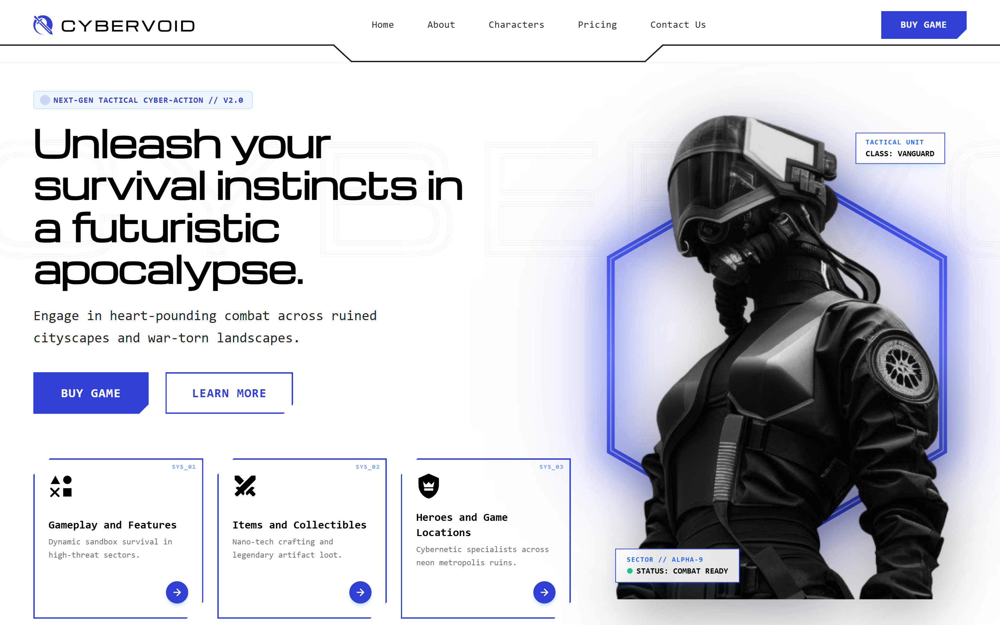
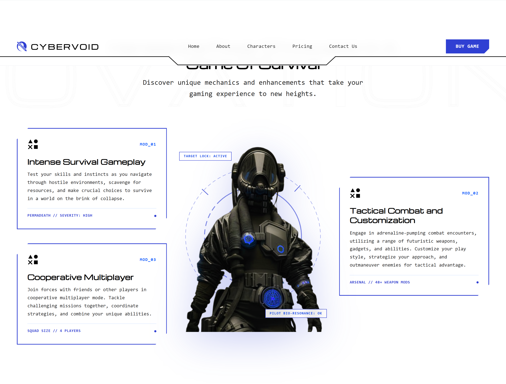
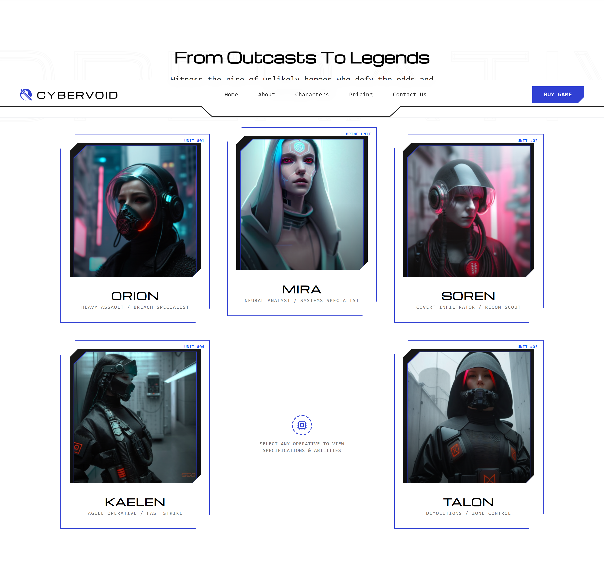
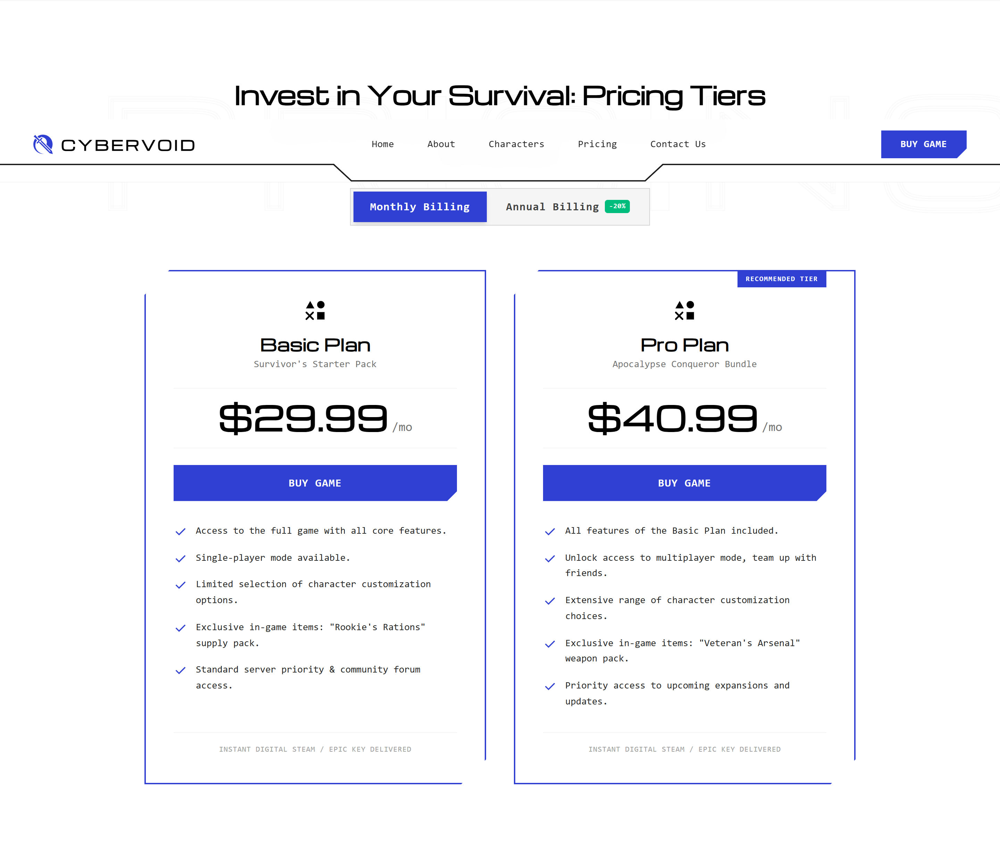
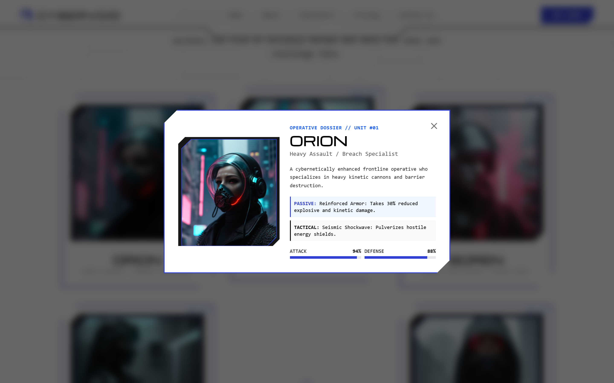
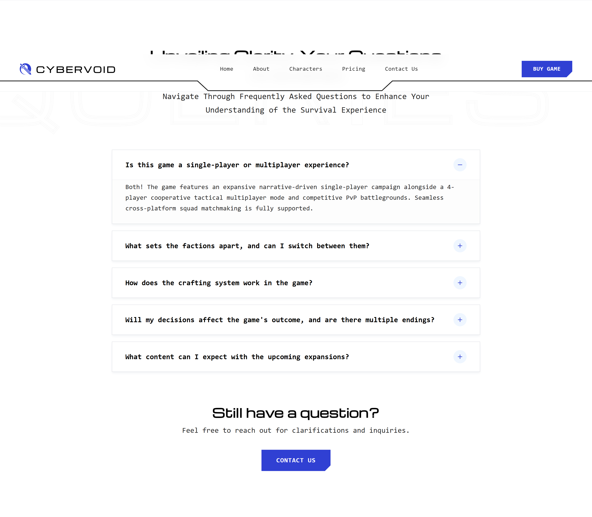
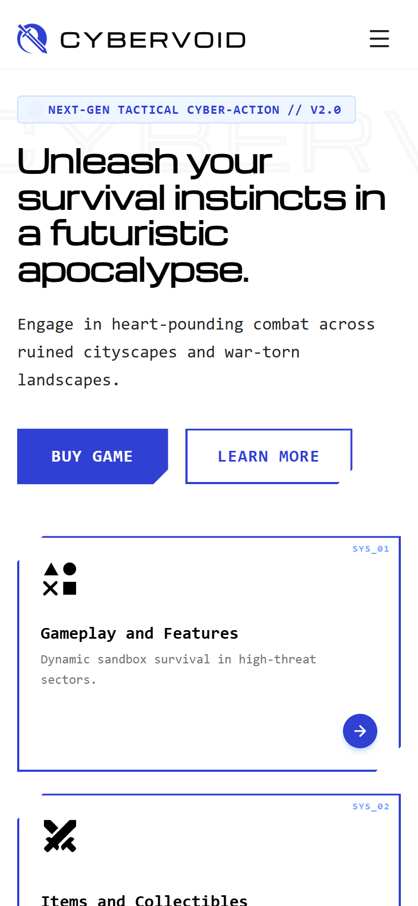

# CYBERVOID - Futuristic Tactical Survival Web Experience

A web application and landing experience for a next-gen tactical apocalypse survival game. Built with React 19, Tailwind CSS v4, and the Web Audio API.

Based on the Figma design specification:
[Futuristic Game Website Landing Page (Figma Community)](https://www.figma.com/design/YO3wO19N4TPPQJzw4LWFOL/Futuristic-Game-Website-Landing-Page--Community-?node-id=0-1)

---

## 📸 Showcase & Visual Walkthrough

| Hero Section & Hologram | Tactical Features & Spec |
|:---:|:---:|
|  |  |

| Operative Roster | Pricing & Deployment Tiers |
|:---:|:---:|
|  |  |

| License Checkout Modal | Operative Dossier Modal |
|:---:|:---:|
|  |  |

| FAQ & Transmission | Mobile Responsive Layout |
|:---:|:---:|
|  |  |

---

## ⚡ Core Features

- **Precision Fidelity**: Chamfered buttons, corner tick-rulers, technical cuts, and electric blue styling.
- **Cyberpunk Holographic Effects**:
  - Animated pulsating neon hexagon backdrop for the vanguard operative.
  - Rotating concentric circular HUD arcs behind the aerial combat pilot.
  - Faded background outline watermark typography.
- **Interactive Operative Roster**:
  - 5 specialists: Magnus, Malcolm, Cypher, Kamui, and Vulkan.
  - Interactive dossiers displaying tactical bio, passive skills, ultimate abilities, and combat stat meters.
- **Dynamic Pricing Engine**:
  - Monthly vs. Annual billing switcher with automatic 20% discount calculations.
  - Feature comparison checklists with custom SVG checkmarks.
- **Interactive Cyber-Checkout**:
  - Platform selector (Steam, Epic, Consoles).
  - Procedural digital license key generator (`CYBER-XXXX-XXXX-XXXX`).
  - Victory confetti burst upon successful deployment.
- **Procedural Web Audio API SFX**:
  - Synthesized high-tech click, hover, and deploy audio feedback without external audio files.
- **Full Responsive Architecture**:
  - Handcrafted for desktop (1440px+), tablet (768px), and mobile (390px) viewports with mobile navigation drawer.

---

## 🛠️ Tech Stack

- **Framework**: React 19 + Vite
- **Styling**: Tailwind CSS v4
- **Typography**: Google Fonts (`Michroma` & `Inconsolata`)
- **Icons**: Custom SVG + Lucide Icons
- **Animation & FX**: CSS Keyframes + Canvas Confetti + Web Audio API

---

## 🚀 Getting Started

```bash
# Clone the repository
git clone https://github.com/lxlnimalxl/futuristic-game-landing.git

# Enter project directory
cd futuristic-game-landing

# Install dependencies
npm install

# Start development server
npm run dev

# Create optimized production build
npm run build
```

---

## 📄 License

This project is licensed under the MIT License - see the [LICENSE](LICENSE) file for details.
